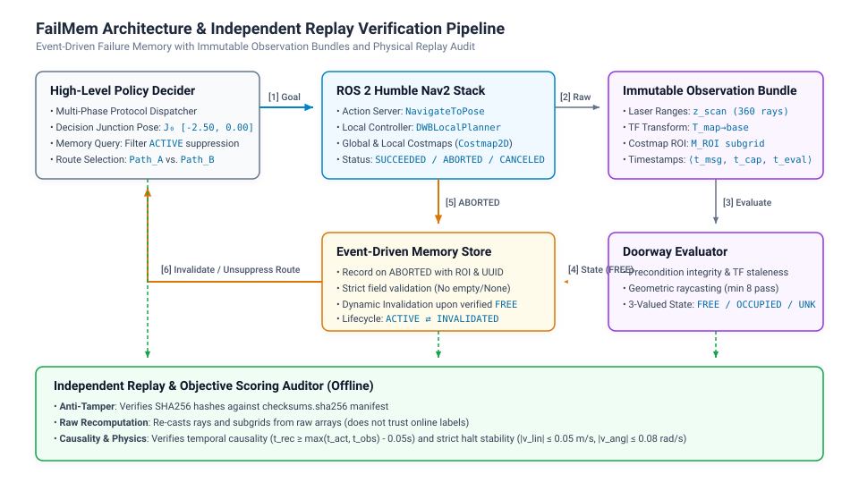
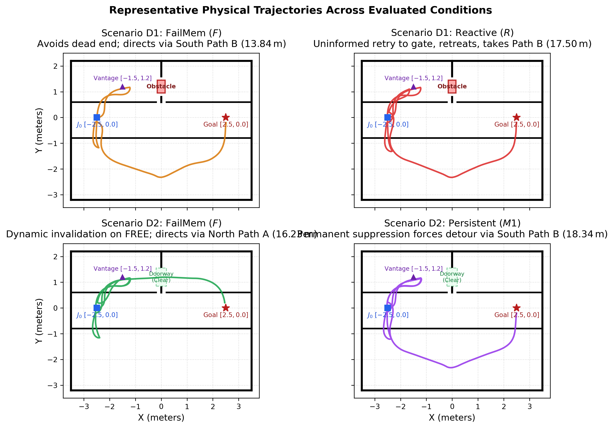

## Abstract

In multi-phase indoor robot navigation, reactive navigation systems lacking cross-phase memory repeatedly re-enter occluded dead-end corridors across sequential tasks when initial line-of-sight is obstructed. We present **FailMem**, an event-driven failure memory architecture for ROS 2 Nav2 that binds navigation aborts to immutable observation bundles—combining raw LiDAR scans, coordinate transforms, and local costmap regions of interest—and provides perception-driven dynamic invalidation when clearance is verified by sensors. Within an asymmetric dual-path environment in Gazebo 11 simulations with a TurtleBot3 robot, we evaluate FailMem across 30 physical runs ($n=3$ per condition under sequential fixed seeds) against reactive retry ($R$), persistent suppression ($M1$), and spatial observation caching ($O$) baselines, alongside an exploratory 4-run feasibility trial on action-conditioned navigation ($H_1$). Memory retention and invalidation are evaluated across sequential phases within a single continuous runner execution session. The evaluation demonstrates that cross-phase memory successfully prevents redundant dead-end exploration in obstructed settings, and dynamic invalidation unsuppresses the shorter route upon blockage removal (reducing travel distance by $\approx 11.0\%$ relative to permanent suppression, though total episode duration showed no observed improvement). Under static 2D geometry, FailMem and spatial caching chose identical topological routes with under $1\%$ difference in distance and duration, showing no additional routing benefit of FailMem over spatial caching in the evaluated layout and run sample. Furthermore, candidate action configurations in $H_1$ did not establish the expected executability divergence (Nav2 returned success in 4/4 runs, with strict physical arrival verified in 3/4 runs; the candidate scenario did not establish the expected executability divergence).

---

## 1. Introduction

Autonomous mobile robots operating in structured indoor facilities—such as warehouses, hospitals, and office corridors—must repeatedly navigate shared corridors and doorways. In dynamic environments, unmapped physical blockages (such as parked delivery carts or closed safety doors) frequently obstruct the nominal shortest path. Standard navigation systems, including the ROS 2 Navigation Stack (Nav2) \cite{macenski2020marathon2, macenski2022ros2}, utilize layered 2D costmaps \cite{lu2014layered} and local recovery behaviors (e.g., in-place rotations, backup maneuvers, costmap clearing). While these recovery routines assist during active trajectory tracking within an individual goal execution, their diagnostic state is discarded upon goal termination. Consequently, in multi-phase tasks where goals are dispatched sequentially from a distant decision junction, a purely reactive agent (lacking cross-phase memory) repeatedly re-enters known dead ends before on-board sensors re-acquire line-of-sight.

To mitigate unguided re-exploration, two primary approaches exist:
1. **Spatial Costmap Caching ($O$)**: Maintaining geometric occupancy in persistent global grids (e.g., Costmap2D \cite{lu2014layered}, OctoMap \cite{hornung2013octomap}, Voxblox \cite{oleynikova2017voxblox}) as sensory observations accumulate.
2. **Episodic Failure Memory ($F$)**: Recording explicit execution aborts, error causes, or symbolic constraints to suppress infeasible route options in high-level dispatching.

While embodied AI frameworks explore language-based reflection (e.g., Reflexion \cite{shinn2023reflexion}, REFLECT \cite{liu2023reflect}), they operate primarily in semantic prompt spaces and lack physical costmap expiration semantics. Conversely, robotics systems rarely formalize verifiable contracts for when episodic failure records should be dynamically invalidated by physical perception. This raises an essential empirical question: *Under what conditions does an autonomous mobile robot genuinely require explicit episodic failure memory over standard spatial costmap caching?*

In this work, we present **FailMem**, an event-driven failure memory architecture for ROS 2 Nav2, and conduct an exploratory empirical study to delineate its operational boundaries. Specifically, we provide:
1. **Perception-Grounded Event Memory and Dynamic Invalidation Implementation**: A ROS 2 Nav2 architecture that binds execution aborts to immutable observation bundles (raw LiDAR scans, TF transforms, costmap ROIs) and executes sensor-verified dynamic invalidation upon clearing.
2. **Auditable Exploratory Navigation Comparison**: A reproducible 30-run benchmark ($n=3$ per condition under sequential fixed seeds) in Gazebo 11 comparing FailMem ($F$) against reactive ($R$), spatial caching ($O$), and persistent suppression ($M1$) baselines across clean (D0), blocked (D1), and restored (D2) scenarios.
3. **Boundary Findings on Failure Memory vs. Spatial Caching**: An empirical finding that within the evaluated static 2D geometry and layout, FailMem yields no observed routing benefit over spatial caching ($O$), selecting identical topological routes ($<1\%$ difference in distance and duration); alongside empirical stopping criteria from an exploratory 4-run feasibility trial where action-conditioned navigation ($H_1$) did not establish executability divergence.

---

## 2. Related Work & Mechanism Taxonomy

### 2.1 Spatial Occupancy Mapping & Distance Fields
Layered 2D costmaps \cite{lu2014layered, macenski2020marathon2} maintain geometric obstacles by ray-casting sensor ranges into grid cells and propagating configuration-space inflation. 3D volumetric frameworks, such as OctoMap \cite{hornung2013octomap}, employ hierarchical octrees with discrete probabilistic voxel occupancy updates. Distance-field frameworks such as Voxblox \cite{oleynikova2017voxblox} incrementally construct continuous Euclidean Signed Distance Fields (ESDF) for smooth trajectory optimization. While spatial mapping accurately maintains geometric free and occupied space, it treats unobserved areas identically and does not capture action-specific execution failures.

### 2.2 Execution Monitoring & Plan Diagnosis
Deliberative robotics frameworks \cite{fikes1971strips, simmons1998xavier, ingrand2017deliberation} formalize plan execution monitoring and diagnostic repair. Modern navigation stacks \cite{macenski2020marathon2} execute recovery behaviors when local planners fail. However, standard recovery states are discarded upon goal termination, requiring explicit cross-phase or cross-task episodic memory stores to guide high-level routing.

### 2.3 LLM Self-Reflection & Agent Memory
Recent embodied AI systems investigate large language models for planning and error correction. Reflexion \cite{shinn2023reflexion} prompts LLMs with scalar task feedback to generate natural language self-reflections. Inner Monologue \cite{huang2023inner} integrates success detectors and scene descriptions into closed-loop prompt chains. REFLECT \cite{liu2023reflect} uses hierarchical multi-modal experience summarization with LLMs to generate structured failure explanations and plan corrections. While these methods demonstrate prompt-level flexibility, they focus on higher-level task reflection. FailMem complements these approaches by investigating event-driven failure recording, perception-driven invalidation, and offline replay auditing directly within the low-level ROS 2 action and costmap stack.

### 2.4 Experience-Based Planning & No-Good Learning
In motion planning, the Lightning framework \cite{berenson2012lightning} and Experience Graphs (E-Graphs) \cite{phillips2012egraphs} reuse libraries of prior successful paths to accelerate search. In discrete optimization, conflict-driven clause learning (e.g., GRASP \cite{marquessilva1999grasp}) records "no-goods" from search dead ends to prune infeasible branches. FailMem adapts the principle of negative constraint recording to mobile robot navigation with explicit sensor-verified invalidation.

Table 1 summarizes the key characteristics across representations and invalidation mechanisms.

| Paradigm | Representation | Grounding Level | Invalidation Trigger |
| :--- | :--- | :--- | :--- |
| **Costmap2D / Nav2** | 2D Occupancy Grid | Geometric cells | Direct laser ray traversal |
| **OctoMap** | 3D Voxel Octree | Discrete 3D voxels | Direct laser ray traversal |
| **Voxblox** | Continuous ESDF / TSDF | 3D Distance Field | Dynamic voxel integration |
| **Experience Graphs** | Path Waypoints / Graph | Discrete Path | Collision check on repair |
| **Reflexion** | Natural Language Text | Semantic tokens | Manual context reset |
| **REFLECT** | Natural Language Text | Multi-modal logs | Session termination |
| **FailMem (Implemented)** | Event Tuple | Raw sensor bundle | Sensor-verified `FREE` state |
| **FailMem F2 (Proposed)** | Profile Tuple | Bundle + Profile | Profile capability check |

---

## 3. The FailMem Architecture

Figure 1 illustrates the overall system architecture, encompassing the execution runtime, immutable observation bundles, and memory lifecycle.

### 3.1 Immutable Observation Bundles
Prior to evaluating passage clearance, FailMem constructs an immutable observation bundle $B$:
$$B = \langle \text{obs\_id}, \mathbf{z}_{\text{scan}}, \mathbf{T}_{\text{map}\to\text{base}}, \mathbf{M}_{\text{costmap\_ROI}}, t_{\text{msg}}, t_{\text{capture}}, t_{\text{eval}} \rangle$$
where $\mathbf{z}_{\text{scan}}$ is the raw range array, $\mathbf{T}_{\text{map}\to\text{base}}$ is the TF transformation, and $\mathbf{M}_{\text{costmap\_ROI}}$ is the extracted 2D subgrid matrix.

### 3.2 Clearance Classification Rules
The passage state is evaluated according to strict geometric criteria implemented in `src/doorway_evaluator.py`:
$$\text{State}(B) = \begin{cases} 
\text{OCCUPIED}, & \text{if } N_{\text{hits\_inside}} \ge 5 \text{ or } N_{\text{costmap\_occupied\_cells}} > 0 \\ 
\text{FREE}, & \text{if } N_{\text{hits\_inside}} = 0 \text{ and } N_{\text{pass\_through}} \ge 8 \text{ and } \text{CostmapCleared}(B) \\ 
\text{UNKNOWN}, & \text{otherwise} 
\end{cases}$$
where $\text{CostmapCleared}(B) \iff (N_{\text{unknown\_cells}} = 0 \land N_{\text{occupied\_cells}} = 0)$ within the doorway ROI $[-0.15, 0.15, 0.95, 1.45]$. (See Supplementary Material S1 for detailed transform alignment and ray projection preconditions).

### 3.3 Memory Lifecycle & Invalidation Mechanics
- **Failure Registration**: When navigation fails within an occupied passage, an active failure record is created:
  $$M = \langle \text{mem\_id}, t_{\text{fail}}, \text{goal\_uuid}, \text{action\_id}, \text{region\_id}, \mathbf{M}_{\text{costmap\_ROI}} \rangle$$
  Active failure records suppress the associated route at Decision Junction $J_0$.
- **Dynamic Invalidation**: When subsequent sensor perception yields $\text{State}(B) = \text{FREE}$ with evidence timestamp $t_{\text{free}} > t_{\text{fail}}$, the memory entry is marked $\text{INVALIDATED}$, unsuppressing the route.
- **Cross-Phase Scope Clarification**: In the current experimental implementation, history collection, memory creation, decision dispatch, and memory reset occur within a single continuous runner session across sequential phases. This evaluates phase-to-phase memory transfer within an experimental run, and has not yet been benchmarked as a persistent multi-task database across separate OS daemon lifetimes.
- **Evaluation Pipeline**: An independent replay auditor verifies all serialized logs against SHA256 checksum manifests (detecting file changes relative to the manifest) and physical halt stability criteria ($|v_{\text{lin}}| \le 0.05\,\text{m/s}, |v_{\text{ang}}| \le 0.08\,\text{rad/s}$) without reliance on self-reported runtime assertions (detailed in Supplementary Material Section S2).

---

## 4. Experimental Setup & Benchmarking Protocol

### 4.1 Physical Simulation Environment & Geometry
Simulations are conducted in ROS 2 Humble with Gazebo 11 simulating a TurtleBot3 Waffle robot in an asymmetric dual-path environment (`configs/p2c_dualpath_world.model`).
- **Path A (North Short Path)**: Waypoint polyline length is $6.124\,\text{m}$ from Decision Junction $J_0 [-2.50, 0.00]$ to Goal $[2.50, 0.00]$ through a $0.80\,\text{m}$ doorway chokepoint at $y=1.20$.
- **Path B (South Bypass Detour)**: Waypoint polyline length is $9.105\,\text{m}$ from $J_0$ to Goal via open corridor at $y=-2.40$.

### 4.2 Distance Metric Definitions
To evaluate performance across different phases, we define:
1. **Decision Distance ($d_{\text{dec}}$)**: Physical odometry distance traversed during Phase 2 after goal dispatch from Decision Junction $J_0$ (Path B direct: $\approx 7.54\,\text{m}$; Path A direct: $\approx 5.89\,\text{m}$).
2. **Total Distance ($d_{\text{tot}}$)**: Cumulative odometry distance spanning both Phase 1 (historical observation/attempt) and Phase 2 (dispatch to goal).

### 4.3 Evaluated Scenarios & Baseline Methods
- **Scenario D0 (Unobstructed)**: Doorway is clear; robot navigates Path A without prior history.
- **Scenario D1 (Blocked)**: Doorway chokepoint is obstructed by a physical obstacle box. Phase 1 executes the following sequence:
  1. *Vantage Navigation*: The robot navigates from Decision Junction $J_0 [-2.50, 0.00]$ to approach vantage waypoint $[-1.00, 1.20, 0.0]$ and captures initial sensor observation bundle;
  2. *Chokepoint Traversal Attempt*: The robot dispatches a genuine Nav2 action attempting chokepoint traversal to $[0.50, 1.20, 0.0]$ with a $15.0\,\text{s}$ timeout;
  3. *Action Termination*: Nav2 execution aborts due to physical obstacle obstruction;
  4. *Failure Memory Creation*: Upon action termination, the robot captures a fresh post-traversal observation bundle confirming `OCCUPIED`, classifies the failure cause, and commits an active failure memory record (or updates spatial cache $O$);
  5. *Structured Return*: The robot executes a return navigation action back to Decision Junction $J_0$.  
  Phase 2 then evaluates routing dispatched from $J_0$. Under Reactive $R$, having no cross-phase memory, the robot dispatches the nominal shortest path (Path A), physically travels to entrance waypoint $[-1.50, 1.20]$, detects the blockage on live sensors, and retreats to $J_0$ before taking Path B. This decision-phase unguided probe in $R$ is strictly distinct from the historical Phase 1 traversal attempt executed in $F$ and $O$.
- **Scenario D2 (Cleared)**: Following D1, the obstacle is removed. Phase 1 observes `FREE` doorway clearance from vantage waypoint $[-1.00, 1.20]$ and retreats to $J_0$. Phase 2 evaluates routing from $J_0$.

**Evaluated Methods**:
1. **Reactive Baseline ($R$)**: No cross-phase memory. In D1, enters Path A approach leg, detects blockage at $[-1.50, 1.20]$, and retreats to $J_0$ before taking Path B.
2. **Spatial Observation Cache ($O$)**: Caches 2D geometric occupancy observed from vantage point during Phase 1. Evaluated at $J_0$ during Phase 2.
3. **FailMem ($F$)**: Event-driven failure memory with dynamic perception-driven invalidation.
4. **Persistent Suppression ($M1$)**: Static failure memory permanently suppressing Path A without dynamic invalidation.

All runs use $n=3$ per condition under sequential fixed seeds with an episode simulation time budget of $180.0\,\text{s}$.

---

## 5. Empirical Results & Boundary Analysis

### 5.1 Condition-Level Performance
Table 2 presents condition-level performance across 30 physical simulation runs ($n=3$ per condition, reporting mean $\pm$ sample standard deviation with Bessel correction $ddof=1$). All 10 conditions achieved a $100\%$ replay audit pass rate ($3/3$), confirming physical halt stability and data completeness across all runs.

<!-- TABLE:table1_condition_summary -->

### 5.2 Pairwise Contrasts & Trajectory Analysis
Table 3 reports pairwise contrast comparisons across evaluated methods, and Figure 2 illustrates representative physical trajectories.

<!-- TABLE:table2_pairwise_contrasts -->

1. **Elimination of Redundant Dead-End Exploration ($F$ vs. $R$)**: In Scenario D1, FailMem ($F$) eliminates redundant entry into the blocked corridor ($0.0$ vs. $1.0$ dead ends), reducing total distance by $-18.5\%$ ($14.03\,\text{m}$ vs. $17.22\,\text{m}$) and simulation duration by $-22.3\%$ ($109.5\,\text{s}$ vs. $141.0\,\text{s}$) relative to Reactive $R$ (Table 3, Figure 2). Reactive $R$'s dead-end traversal represents an unguided retry to the entrance waypoint, not physical collision.
2. **Prevention of Detour Overhead ($F$ vs. $M1$)**: In Scenario D2, dynamic invalidation upon observing `FREE` unsuppresses Path A, reducing total distance by $\approx 11.0\%$ ($2.00\,\text{m}$, $16.25\,\text{m}$ vs. $18.25\,\text{m}$) relative to persistent suppression ($M1$). However, in the current 3-run exploratory evaluation, average total simulation duration showed no observed improvement and increased slightly by $\approx 1.5\%$ ($151.1\,\text{s}$ vs. $148.8\,\text{s}$, a sample mean difference of $+2.27\,\text{s}$). An independent three-phase trajectory time ledger analysis (`reports/evidence/d2_time_ledger/`) reveals the empirical source of this discrepancy: the $+2.27\,\text{s}$ full-episode duration sample mean difference was accrued predominantly during the **History Exploration Phase** ($t < T_{\text{history}}$), where FailMem took $100.00 \pm 7.72\,\text{s}$ vs. $M1$'s $97.53 \pm 2.12\,\text{s}$ (a $+2.47\,\text{s}$ exploration sample mean difference accrued prior to route dispatching). During the **Decision Phase** ($t \ge T_{\text{history}}$), execution durations between FailMem and $M1$ were virtually identical ($51.10 \pm 0.95\,\text{s}$ vs. $51.30 \pm 2.00\,\text{s}$, a difference of only $-0.20\,\text{s}$), indicating no observable end-to-end time advantage for Path A in this benchmark. An exploratory kinematic decomposition shows that along Path A, active moving time was shorter ($28.70 \pm 1.18\,\text{s}$ vs. $34.30 \pm 1.76\,\text{s}$ at default thresholds, a sample mean difference of $-5.60\,\text{s}$), reflecting shorter path length ($5.89\,\text{m}$ vs. $7.89\,\text{m}$), while stopped time was longer ($15.83 \pm 2.42\,\text{s}$ vs. $12.13 \pm 1.41\,\text{s}$, a sample mean difference of $+3.70\,\text{s}$), alongside independent doorway clearance settling window measurements ($6.97 \pm 0.06\,\text{s}$ vs. $4.60 \pm 0.00\,\text{s}$). Because component durations vary with discretization thresholds (active moving difference spans $-5.10\,\text{s}$ to $-6.80\,\text{s}$ and stationary difference spans $+3.10\,\text{s}$ to $+5.20\,\text{s}$ across linear velocity thresholds $0.03\text{--}0.08\,\text{m/s}$ in our sensitivity analysis, Supplementary Material Section S5), we report these as coarse-grained observational latencies rather than asserting an invariant physical mechanism.
3. **Comparison with Spatial Caching in Static 2D Geometry ($F$ vs. $O$)**: In both D1 and D2, FailMem ($F$) and Spatial Cache ($O$) selected identical topological routes. Total distance differences ($+0.6\%$ in D1, $-0.9\%$ in D2) and total duration differences ($+0.7\%$ in D1, $+0.9\%$ in D2) remained under $1\%$. *In this layout and current run sample, no additional routing benefit of $F$ over $O$ was observed; this does not imply general lack of benefit across arbitrary domains or statistical equivalence.* Notably, dynamic recovery upon obstacle removal is not exclusive to FailMem; spatial costmap caching ($O$) likewise updates its internal occupancy state and unblocks routes upon acquiring new sensory observations.

### 5.3 Feasibility Check for Action-Conditioned Navigation ($H_1$)
To investigate whether action configurations (aligned $a_{\text{aligned}}$ vs. doorpost boundary-biased oblique $a_{\text{oblique}}$) create executability differences in an unobstructed doorway, a fixed 4-run feasibility check was conducted (`reports/evidence/p2d_h1_feasibility/`).

<!-- TABLE:table3_h1_feasibility -->

Table 4 summarizes the feasibility trial outcomes. Nav2 returned `SUCCEEDED` (status code 4) in all 4/4 runs, and strict physical arrival was verified in 3/4 runs (`H1_aligned_run1` exceeded the angular velocity halt threshold during the stability window: $0.1068 > 0.08\,\text{rad/s}$). Nav2's `DWBLocalPlanner` navigated the passage without planner abortion across all runs.  
**Decision & Conclusion**: *Nav2 returned success in 4/4 runs, with strict physical arrival verified in 3/4 runs; this candidate scenario did not establish the expected executability divergence across actions. Exploration for this hypothesis was therefore stopped per protocol, which does not constitute a refutation of the general action-conditioned failure memory hypothesis.*

---

## 6. Threats to Validity & Limitations

1. **Exploratory Sample Size**: The 30-run comparative pilot ($n=3$ per condition) serves as an exploratory demonstration of mechanism functioning and auditability; it does not constitute large-sample asymptotic hypothesis testing.
2. **Simulation Fidelity**: Evaluated in Gazebo 11 simulation with nominal sensor models. Hardware deployments with real-world sensor dropout, dynamic obstacles, and adversarial conditions are subject to future research.
3. **Conceptual Extensions ($F2, O+$)**: Action-profiled failure memory ($F2$) and backoff spatial caching ($O+$) are formalized as conceptual models in project documentation but have not yet been evaluated in simulation.
4. **Within-Session Phase-Level Scope**: Memory evaluation is restricted to sequential phases within a single continuous experimental execution session. Cross-task persistence across operating system restarts, long-term storage indexing, and multi-day operation remain unverified.

---

## 7. Conclusion

This paper presented FailMem, an event-driven failure memory architecture for autonomous mobile robots. By binding execution failures to immutable observation bundles and providing an independent replay audit pipeline, FailMem establishes rigorous standards for reproducible robotics evaluation. Our empirical findings demonstrate that historical information eliminates redundant dead-end exploration relative to reactive retry, and dynamic state updates (available in both FailMem and spatial caching) prevent permanent detour traps upon environmental recovery. In the evaluated layout and run sample, no additional routing benefit of explicit failure memory over spatial caching was observed. These findings provide an auditable, reproducible benchmark and empirical stopping rationale to guide future research on action-conditioned and multi-agent memory systems.

---

## References

\bibliographystyle{IEEEtran}
\bibliography{references}

