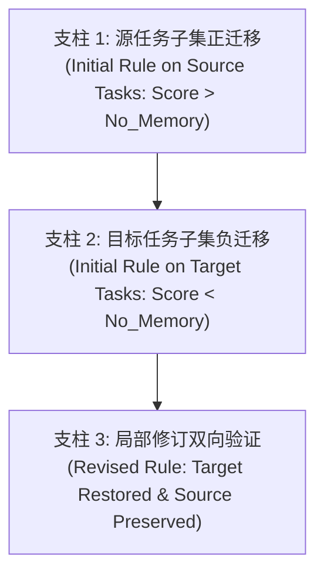
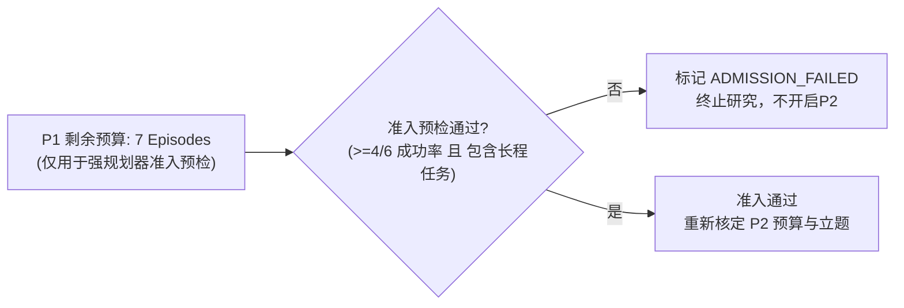

# 反例局部条件修订研究协议 (Counterexample Revision Protocol)

**版本号**：1.0 (Frozen Protocol)  
**基准分支**：`research/counterexample-condition-revision`  
**基线 Commit**：`e87026d`  
**制定时间**：2026-10-22  

---

## 1. 研究假说与核心问题 (Hypothesis & Research Question)

### 1.1 假说 (Hypothesis)
智能体在科学模拟环境（如 ScienceWorld）中利用失败轨迹/反例生成动作规则时，往往由于反思过程对上下文局部线索的过度抽象，形成**触发条件过于宽泛（Over-generalized Preconditions）**的经验规则。当该规则迁移到表观相似但因果逻辑不同的目标任务子集时，会诱发有害的动作偏向或死循环（负迁移）。  
**局部条件修订（Local Condition Revision）**假说认为：通过仅对经验规则的局部适用前置条件（Applicability Conditions / Preconditions）进行精确收紧与因果边界澄清，而保持核心行动经验主干不变，可以在完全消除目标任务负迁移的同时，无损保留源任务中的正向收益。

### 1.2 核心研究问题 (Research Questions)
1. **RQ1（负迁移的经验再现）**：在强规划器与纯原生动作直通环境下，反例经验规则是否在目标子任务上表现出统计显著且因果清晰的负迁移？
2. **RQ2（局部修订的有效性）**：相较于“完全丢弃”或“全局重写”，“局部条件修订”是否能在消除目标任务负迁移的同时，最高效地保留源任务的正向收益？
3. **RQ3（机制特异性）**：收益是否真正来自局部条件的因果收紧，而非提示词长度变化、解码随机性或偶然的动作重排序？

---

## 2. 论证成立所必需的三项经验证据链 (Three Necessary Evidentiary Pillars)

任何宣称“局部条件修订机制有效”的研究结论，必须在同一冻结评测集与统一模型配置下，完整且依序建立以下**三项经验证据链**。缺少其中任何一项，均判定为论据不充分：

1. **证据支柱 1：源任务子集上的明确正迁移 (Positive Transfer on Source Subset)**  
   - 提取自失败反例的初始经验规则 $R_0$，在源任务子集 $\mathcal{T}_{\text{source}}$ 上必须显著提升任务成功率或缩短完成步数：  
     $$\text{Performance}(R_0 \mid \mathcal{T}_{\text{source}}) > \text{Performance}(\text{No\_Memory} \mid \mathcal{T}_{\text{source}})$$

2. **证据支柱 2：目标任务子集上的明确负迁移 (Negative Transfer on Target Subset)**  
   - 将相同的初始经验规则 $R_0$ 原样迁移至目标任务子集 $\mathcal{T}_{\text{target}}$ 时，必须出现明确、可复现的性能衰退或环境拒绝：  
     $$\text{Performance}(R_0 \mid \mathcal{T}_{\text{target}}) < \text{Performance}(\text{No\_Memory} \mid \mathcal{T}_{\text{target}})$$  
   - 且衰退必须能追溯到规则诱导的特定错误动作执行。

3. **证据支柱 3：修订后负迁移消除且正迁移无损 (Target Restored & Source Preserved)**  
   - 经过局部条件修订后的新规则 $R_{\text{revised}}$，必须同时满足两个方向的统计检验：  
     - **目标任务修复**：在目标子集上消除负迁移，恢复到无记忆基线水平或更高：  
       $$\text{Performance}(R_{\text{revised}} \mid \mathcal{T}_{\text{target}}) \ge \text{Performance}(\text{No\_Memory} \mid \mathcal{T}_{\text{target}})$$  
     - **源任务保留**：在源任务子集上完整保留初始正向收益，无显著性能衰退：  
       $$\text{Performance}(R_{\text{revised}} \mid \mathcal{T}_{\text{source}}) \approx \text{Performance}(R_0 \mid \mathcal{T}_{\text{source}}) > \text{Performance}(\text{No\_Memory} \mid \mathcal{T}_{\text{source}})$$

---

## 3. 五项严格受控实验对照条件 (Five Controlled Experimental Conditions)

为消除混杂因素，所有后续评估必须横跨以下 5 个受控条件：

| 实验条件 | 条件代号 | 记忆内容与操作机制 | 检验目标 |
| :--- | :--- | :--- | :--- |
| **无记忆对照** | `No_Memory` | `extra_context = ""` | 确立纯任务能力基线性能与动作轨迹 |
| **原样反例记忆** | `Unchanged_Memory` | 注入未修改的初始反例规则 $R_0$ | 检验是否存在负迁移现象（支柱 2 检验） |
| **直接删除基线** | `Delete_Memory` | 检测到冲突/失败后直接将规则置空 | 最保守的基线：避免负迁移但完全损失正迁移潜力 |
| **全局重写基线** | `Global_Rewrite` | 由 LLM 无约束通篇重新生成反思规则 | 检验全局重新总结是否引发灾难性遗忘或逻辑漂移 |
| **局部条件修订** | `Local_Condition_Revision` | 仅修订 precondition/trigger 字段，固定行动方案 | 验证精确局部因果收紧的独特优越性（支柱 3 检验） |

---

## 4. 统一且冻结的强规划器规则 (Frozen Strong Planner Rule)

此前在本地小型模型（Qwen2.5-Coder-7B、Qwen3-14B-AWQ）上的诊断表明，弱规划器受限于内在指令遵循与动作语法空间建模能力，无法建立有效基线。接入远程强规划器时必须严格遵守以下冻结规则：

1. **模型与超参数全流程冻结**：  
   - 一旦在准入测试中确定强规划器模型 ID（如 `gpt-4o` 或 `deepseek-chat`），后续整个研究周期中**严格冻结**；
   - 严禁在源任务、目标任务或不同对照组之间更换模型或模型版本；
   - 解码超参数全局锁定：`temperature=0.0`（贪婪确定性解码），`top_p=1.0`，`max_tokens=256`。
2. **禁止针对任务微调或定制提示词**：  
   - 系统提示词与动作交互格式保持统一（使用标准 `SYSTEM_PROMPT_ACTION_TEMPLATES` 与 `prompt_mode="action_templates"`）；
   - 严禁在提示词中人为硬编码针对特定 variation 的补丁逻辑或特异性先验。
3. **原生动作直通保证**：  
   - 统一采用 `adapter_mode="native"`，严格依靠规划器自身的语法理解与任务推理，禁止任何外部动作名称替换或作弊补全。

---

## 5. 预算隔离与分阶段准入原则 (Budget Isolation & Phased Admission)

为防止资源滥用与无边界试错，实施严格的分阶段预算红线：

1. **P1 剩余预算专门用途**：  
   - P1 累计消耗 153/160 episodes，**剩余 7 个 episodes**；
   - 剩余 7 个 episodes **仅且只能用于远程强规划器的基础准入预检**（例如运行 6 个基准任务）；
   - 在准入预检前，严禁调用任何额外的实验轮次。
2. **准入判定红线 (Admission Gate)**：  
   - 强规划器在 6 个无记忆基准任务（涵盖简单聚焦、导电性测试、长程状态转变如融化/沸腾）中，必须达成：  
     $$\text{Success Count} \ge 4/6 \quad \text{且必须成功完成至少一项长程多步物理交互任务}$$
3. **P2 状态与重新核定机制**：  
   - P2 当前处于 `TERMINATED_NO_GO` 状态；
   - 若强规划器未能通过 7 个 episode 内的准入测试，立即终止实验，保持终止决定；
   - 若准入通过，亦不得擅自消耗历史 P2 额度，必须在用户审核同意下重新立题、明确核定 P2 新预算后，方可开展局部条件修订的主体实验。
