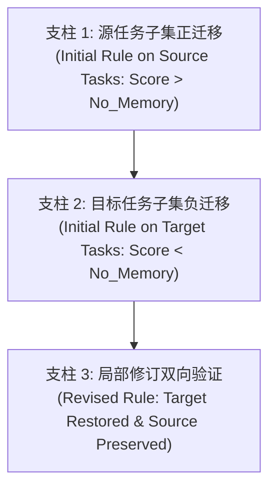

# 反例局部条件修订研究协议 (Counterexample Revision Protocol)

**版本号**：1.1 (Synchronized Protocol)  
**基准分支**：`research/counterexample-condition-revision`  
**更新时间**：2026-10-22  

---

## 1. 研究假说与核心问题 (Hypothesis & Research Question)

### 1.1 假说与待检验目标 (Hypothesis & Goals to be Tested)
智能体在科学模拟环境（如 ScienceWorld）中利用失败轨迹/反例生成动作规则时，往往由于反思过程对上下文局部线索的过度抽象，形成**触发条件过于宽泛（Over-generalized Preconditions）**的经验规则。当该规则迁移到表观相似但因果逻辑不同的目标任务子集时，会诱发有害的动作偏向或死循环（负迁移）。  
**局部条件修订（Local Condition Revision）**假说将以下两点确立为核心**待检验目标 (Goals to be Tested)**，而非先验结论：
1. **负迁移消除**：仅通过对经验规则的局部适用前置条件（Applicability Conditions / Preconditions）进行精确收紧与因果边界澄清，能否有效消除目标任务中的负迁移？
2. **正向经验保留**：在保持核心行动主干不变的前提下，能否在源任务子集上实质性保留最初由反例带来的正向收益？

### 1.2 核心研究问题 (Research Questions)
1. **RQ1（负迁移的经验再现）**：在强规划器与纯原生动作直通环境下，反例经验规则是否在目标子任务上表现出统计显著且因果清晰的负迁移？
2. **RQ2（局部修订的有效性）**：相较于“完全丢弃”或“全局重写”，“局部条件修订”是否能在消除目标任务负迁移的同时，最高效地保留源任务的正向收益？
3. **RQ3（机制特异性）**：收益是否真正来自局部条件的因果收紧，而非提示词长度变化、服务端随机波动或偶然的动作重排序？

---

## 2. 论证成立所必需的三项经验证据链 (Three Necessary Evidentiary Pillars)

任何宣称“局部条件修订机制有效”的研究结论，必须在同一冻结评测集与统一模型配置下，完整且依序建立以下**三项经验证据链**。缺少其中任何一项，均判定为论据不充分：

1. **证据支柱 1：源任务子集上的明确正迁移 (Positive Transfer on Source Subset)**  
   - 提取自失败反例的初始经验规则 $R_0$，在源任务子集 $\mathcal{T}_{\text{source}}$ 上必须显著提升任务成功率或缩短完成步数：  
     $$\text{Performance}(R_0 \mid \mathcal{T}_{\text{source}}) > \text{Performance}(\text{No\_Memory} \mid \mathcal{T}_{\text{source}})$$

2. **证据支柱 2：目标任务子集上的明确负迁移 (Negative Transfer on Target Subset)**  
   - 将相同的初始经验规则 $R_0$ 原样迁移至目标任务子集 $\mathcal{T}_{\text{target}}$ 时，必须出现明确、可复现的性能衰退或环境拒绝：  
     $$\text{Performance}(R_0 \mid \mathcal{T}_{\text{target}}) < \text{Performance}(\text{No\_Memory} \mid \mathcal{T}_{\text{target}})$$  
   - 且衰退必须能追溯到规则诱导的特定错误动作执行。

3. **证据支柱 3：修订后目标任务负迁移消除与源任务正向收益保留（待检验目标）**  
   - 经过局部条件修订后的新规则 $R_{\text{revised}}$，必须同时满足两个方向的实证检验：  
     - **目标任务修复**：在目标子集上消除负迁移，恢复到无记忆基线水平或更高：  
       $$\text{Performance}(R_{\text{revised}} \mid \mathcal{T}_{\text{target}}) \ge \text{Performance}(\text{No\_Memory} \mid \mathcal{T}_{\text{target}})$$  
     - **源任务实质保留**：必须在源任务子集上提供确凿的正向收益实质保留证据；不能简单将“统计上未出现显著下降”等同于“证明了收益被完整保留”。

---

## 3. 三类数据集的严格划分 (Data Separation Requirements)

为防止信息泄露与过拟合，实验必须在数据流上严格物理隔离以下三类数据：

1. **经验生成数据 (Experience Generation Data)**：  
   - 用于提取初始反例规则 $R_0$ 的原始失败轨迹；仅来自特定的源任务探索。
2. **修订反例数据 (Revision Counterexample Data)**：  
   - 在迁移中暴露过度宽泛前置条件的冲突/失败样本；仅用于驱动局部条件的因果收紧，不得用于后续最终评价。
3. **独立评估数据 (Independent Evaluation Data)**：  
   - 完全留出的独立测试子集（未参与任何规则生成或条件修订）；所有的消融对比、基线评测与收益保留检验必须在此独立集上封闭进行。

---

## 4. 五项严格受控实验对照条件 (Five Controlled Experimental Conditions)

为消除混杂因素，所有后续评估必须横跨以下 5 个受控条件：

| 实验条件 | 条件代号 | 记忆内容与操作机制 | 检验目标 |
| :--- | :--- | :--- | :--- |
| **无记忆对照** | `No_Memory` | `extra_context = ""` | 确立纯任务能力基线性能与动作轨迹 |
| **原样反例记忆** | `Unchanged_Memory` | 注入未修改的初始反例规则 $R_0$ | 检验是否存在负迁移现象（支柱 2 检验） |
| **直接删除基线** | `Delete_Memory` | 检测到冲突/失败后直接将规则置空 | 最保守的基线：避免负迁移但完全损失正迁移潜力 |
| **全局重写基线** | `Global_Rewrite` | 由 LLM 无约束通篇重新生成反思规则 | 检验全局重新总结是否引发灾难性遗忘或逻辑漂移 |
| **局部条件修订** | `Local_Condition_Revision` | 仅修订 precondition/trigger 字段，固定行动方案 | 验证精确局部因果收紧的独特优越性（支柱 3 检验） |

---

## 5. 统一且冻结的强规划器规则与环境交互原则 (Frozen Strong Planner Rule)

1. **模型与超参数全流程冻结**：  
   - 一旦在准入测试中确定强规划器模型 ID（如 `deepseek-flash`），后续整个研究周期中**严格冻结**；
   - 严禁在源任务、目标任务或不同对照组之间更换模型或模型版本；
   - 解码超参数固定（不发送未经审定的 temperature 或 top_p，固定 max_tokens=8192 与 thinking/reasoning_effort 配置）；
   - **关于确定性的说明**：删除任何“temperature=0 即可保证完全确定性”的断言。远程商业 API 服务端受并发批处理调度与混合专家（MoE）动态路由影响，天然存在微小的输出波动。因此本地随机种子（如 3407）仅用于固定环境内部逻辑，不宣称对远程模型具备绝对确定性控制。
2. **禁止针对任务微调或定制提示词**：  
   - 系统提示词与动作交互格式保持统一（使用标准 `SYSTEM_PROMPT_ACTION_TEMPLATES` 与 `prompt_mode="action_templates"`）；
   - 动作模板动态来源于环境 `env.get_action_templates()`，禁止硬编码或针对特定任务修改。
3. **原生动作直通保证**：  
   - 统一采用 `adapter_mode="native"`，严格依靠规划器自身的语法理解与任务推理，禁止任何外部动作名称替换或作弊补全。

---

## 6. 预算隔离与准入判定边界 (Budget Isolation & Boundary of Admission Failure)

1. **预算红线与 P1/P2 隔离**：  
   - P1 预算为 160 个 episodes。准入预检执行 6 项任务后，消耗增至 159/160 episodes，剩余 1 个 episode 预算；
   - P2 预算必须重新核定，即便准入预检通过，也不得自动开启 P2 或擅自扩展记忆机制实验。
2. **准入判定红线 (Admission Gate)**：  
   - 规划器在 6 个无记忆基准任务（涵盖简单聚焦、导电性测试、长程状态转变如融化/沸腾）中，必须达成：  
     $$\text{Success Count} \ge 4/6 \quad \text{且必须成功完成至少一项长程多步物理交互任务（melt 或 boil）}$$
3. **准入未通过的结论边界**：  
   - 若规划器未能达到准入指标，判定为 `REMOTE_PLANNER_ADMISSION_FAILED`；
   - **结论边界**：准入失败仅表明“当前测试的特定模型与提示词配置在 ScienceWorld 基础规划基线任务上不达标”，属于基准工程筛选结果，**严禁将其直接推广为对整个失败记忆机制或反例条件修订研究方向的否定**。
