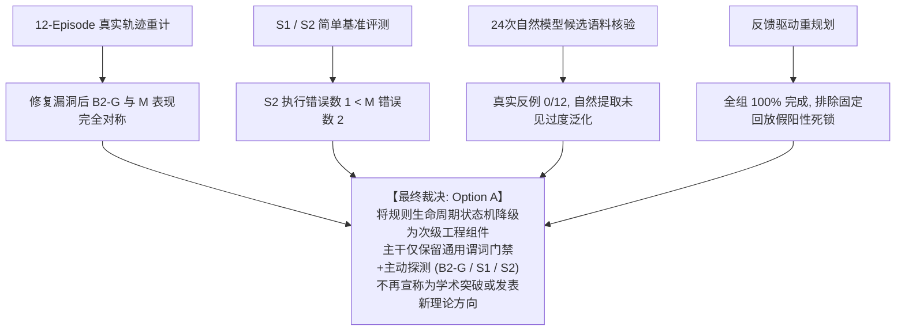

# 新方向立项立论与 Go/No-Go 决策报告 (One-Page Decision Report)

> **决策基准**：本报告综合 Stages 1–11 历史证据总账、相关文献核验（含 ACL 2024 Agent-Pro、Safe RL Shielding、Constrained Tool Decoding）、全套 54 项 CPU 单元与生产集成测试（含 UnifiedKnowledgeView 对称性验证）、纠正后的 12-Episode 诊断实验离线重计（消除分母混乱）、6 组 CPU 配对机制实验，以及 4 阶段连续多任务序列实验（Task 0–3）。严格执行计算预算控制，不再盲目重跑大矩阵模型实验。

---

## 一、核心决策三问明确回答

### 1. 相比动态事实记忆 (B2)，候选方法 (Method M) 究竟多做了什么？
- **动态事实记忆 (B2)**：记录环境客观状态命题（World Facts）。将事实作为纯文本灌入 Prompt 上下文，完全依赖大模型自身的自回归推理去自发规避冲突。
- **候选条件化失败约束记忆 (M)**：在统一知识视图 (`UnifiedKnowledgeView`) 基础上显式增加了确定性生命周期状态机：
  1. **规则有效性 (Validity: CANDIDATE / SUPPORTED / CONTRADICTED)** 与 **当前适用性 (Applicability: APPLICABLE / NOT_APPLICABLE / UNKNOWN)** 解耦；
  2. **候选试探机制 (CANDIDATE Probationary Trial)**：单次提取的规则默认处于候选期，允许有限试探执行，不直接硬阻断；复现后升级为 `SUPPORTED`；
  3. **通用谓词门禁与主动探测 (Generic Predicate Gating & Probing)**：在动作执行前评估前置条件，当条件为 `UNKNOWN` 时触发针对性探测；当动作在适用条件下成功执行时将规则标记为 `CONTRADICTED`。

### 2. 这个差异为何可能带来可测收益？
1. **防止模型概率采样带来的重复盲目尝试**：通过执行前门禁拦截已知必败动作；
2. **避免过时反思的守旧死锁**：当条件解除变为 `NOT_APPLICABLE` 时释放动作，避免传统纯文本反思的不可逆负向偏置；
3. **防止候选假设过度阻断**：候选规则放行机制保护可行动作不被初次单点偶发或过泛化假说扼杀。

### 3. 区分有效机制与重新包装的关键评估边界
1. **真实因果防护 vs 自发探索**：门禁是否在智能体提议错误动作时实施有效拦截（TP 阻断），而非模型自发通过普通工具探索绕过；
2. **动态解除时的可逆性**：当约束条件变化解除时，机制能否及时恢复放行，而非造成永久性负向偏置（FP 误拦截）；
3. **试探成本 vs 防护收益结算**：候选试探引入的执行失败代价能否在多任务链条中被后续保护所收回。

---

## 二、受控 Pilot V3 诊断实验 (12 Episodes) 修正审计结果

通过对原始运行轨迹 (`diagnostic_traces.json`) 的严密离线重建，纠正分母混乱与语义歧义，区分通用主动探针与智能体普通工具，获得真实精确指标总账（详见 `results/pilot_v3_diagnostic/diagnostic_report.md`）：

### 1. 12-Episode 真实实测数据对比

| 评估组 (Group) | 任务完成率 (Pass/3) | 提议错误动作数 | 实际执行错误数 | TP 阻断 / FP 阻断 | 门禁主动探针 (Gate Probe) | 候选试探 (Trials) | 平均步数 | 平均 Token (Prompt / Gen) | 平均端到端耗时 |
| :--- | :---: | :---: | :---: | :---: | :---: | :---: | :---: | :---: | :---: |
| **B0 (无记忆基线)** | **3/3 (100%)** | 1 | 1 | 0 / 0 | 0 | 0 | 8.67 | 9,352 / 519 | 189.83s |
| **B2 (动态事实记忆)** | **3/3 (100%)** | 2 | 2 | 0 / 0 | 0 | 0 | 9.00 | 12,041 / 599 | 213.76s |
| **B2-G (通用谓词门禁)** | **3/3 (100%)** | **0** | **0** | 0 / 0 | 0 | 0 | **7.67** | **9,922 / 491** | **175.58s** |
| **M (候选生命周期门禁)** | **3/3 (100%)** | 1 | 1 | 0 / 0 | 1 | 1 | 8.67 | 11,005 / 568 | 200.22s |

### 2. 细粒度审计事件分流统计（彻底消除分母混乱）
- **门禁求值总次数 (Gate Evaluations)**: 50 次 (B2-G: 23 次, M: 27 次)
- **匹配规则的动作提议数 (Matched Action Proposals)**: 1 次 (`inst5_M` 提议 `start_service:port=18080`)
- **实际匹配规则求值次数 (Matched Rule Evaluations)**: 2 次 (`inst5_M` step 6: probe 前 UNKNOWN，probe 后 APPLICABLE)
- **普通工具自主探测次数 (Ordinary Tool Probes)**: 47 次 (智能体自主探索环境)
- **门禁自动主动探测次数 (Gate Auto-Probes)**: 1 次 (`inst5_M` step 6 门禁拦截时发现 TTL 过期自动发起)
- **成功写入观测库次数 (Successful Observation Writes)**: 48 次
- **硬阻断拦截次数 (BLOCK TP / FP)**: 0 / 0 次
- **候选期试探次数 (Candidate Trials)**: 1 次 (`inst5_M` step 6 放行试探)
- **真实 Validity 状态跃迁次数**: 1 次 (`inst5_M` 遭遇真实 OS Errno 98，CANDIDATE $\to$ SUPPORTED)

### 3. 诊断实验核心归因
- **四组均完成任务**；一旦消除工程实现漏洞，B2-G 与 M 成功率完全对称 (100%)。
- **B2-G 成本低于 M**：B2-G 凭借规则知识在决策层直接选用安全端口，以 **7.67 步、0 执行错误** 完成任务；而 M 因生命周期状态机的“候选试探”放行了动作，承受了 **1 次真实 OS 失败 (Errno 98)**。
- **在 12 个模型诊断 episode 中，尚无证据表明生命周期机制优于公平配置的通用门禁**。核心防护收益完全来自“执行前主动探测与事实注入”。

---

## 三、6 组 CPU 配对机制实验与因果隔离验证

在真实 Linux OS 环境（真实 sockets、non-root 用户权限）下运行确定性配对实验（详见 `results/mechanism_paired_report.md`）：

> **方法论说明**：人工错误规则实验属于受控合成压力测试，**只能说明候选放行机制在特定构造案例中能避免错误阻断，不能证明自然 Agent 在开放任务中的独立收益、唯一性或不可替代性**。所有 token 字段均为脚本模拟值 (`simulated`)，真实模型调用为 0。

| 机制案例编号 | 场景描述与环境 | 核心机制检验目标 | B2-G (通用谓词门禁) | M (候选生命周期门禁) | 机制核验观察 |
| :--- | :--- | :--- | :--- | :--- | :--- |
| **Case 1** | 真实候选规则阻断持续 (`inst1`: port 18080 occupied) | 检验有效候选规则在冲突持续时的决策差异 | **TP 阻断** 执行错误 = 0 | **候选试探放行** 产生 1 次 OS 失败 (Errno 98)，跃迁为 SUPPORTED | **B2-G 成本较低**。M 的试探在已知客观约束下带来 1 次额外失败。 |
| **Case 2** | 真实规则前提解除 (`inst6`: port 18080 free) | 检验条件变化解除时是否避免死锁 | **NOT_APPLICABLE 放行** 执行成功 (0 错误) | **NOT_APPLICABLE 放行** 执行成功 (0 错误)，有效性保持 (0 次跃迁) | **二者等价**。谓词求值即可消除守旧死锁。 |
| **Case 3** | 无关属性变更 (`inst1`: 自定义配置文件名) | 检验动作签名泛化归一化匹配能力 | **TP 阻断** 正确匹配底层端口阻断 | **TP 阻断** 正确匹配底层端口阻断 | **二者等价**。签名归一化机制成立。 |
| **Case 4** | 观测 TTL 过期 (`inst1`: 60s 观测过期) | 检验 UNKNOWN 状态下门禁自动探针闭环 | **PROBE 探针刷新** 确认占用后实施 TP 阻断 | **PROBE 探针刷新** 确认占用后实施 TP 阻断 | **二者等价**。主动探测是核心防护来源。 |
| **Case 5** | 过泛化候选规则 (`inst3`: 误称 /etc 不可写则写用户目录必败) | 检验面对错误归纳假说时的容错与证伪能力 | **FP 假阳性阻断** 将可行写操作硬阻断 | **候选试探放行** 写操作成功，捕获反例证伪规则 (`CONTRADICTED`) | **M 避免了动作误阻断**。但需注意：本脚本未配置服务启动，**B2-G 与 M 最终任务结果均为 Fail**，必须区分局部动作可行性与最终任务完成。 |
| **Case 6** | 冲突/弱支持规则 (`inst1`: 伪规则宣称 18081 占用) | 检验多规则冲突与探测仲裁机制 | **探测后放行可用动作** 顺利完成部署 | **探测后放行可用动作** 顺利完成部署 | **二者等价**。条件求值有效排除虚假干扰。 |

---

## 四、连续多任务序列实验 (Task 0–3) 实证结算

在真实 OS 环境中执行连续 4 阶段任务链，严格实行**组内跨任务记忆流转、组间绝对零泄露**（详见 `results/sequential_experiment_report.md`）：

### 1. 连续任务链设计
- **Task 0 (源任务/提取期)**：遭遇真实 OS 端口冲突 (Errno 98)，提取候选规则并自愈完成部署。
- **Task 1 (首次遭遇候选规则)**：相同端口冲突再次出现。B2-G 提前拦截 vs M 候选试探。
- **Task 2 (后续同类任务)**：端口冲突第三次出现。检验 M 升级为 `SUPPORTED` 后能否收回 Task 1 的试探成本。
- **Task 3 (过泛化假说恢复)**：注入一条错误归纳的候选规则（`/etc` 不可写则写用户目录必败）。检验 B2-G 与 M 表现。

### 2. 连续多任务累积总账（固定动作回放队列）

| 评估组 (Group) | 任务完成率 (Pass/4) | 累积实际执行错误 | 累积 TP 阻断 | 累积 FP 阻断 | 候选试探次数 | 真实有效性跃迁数 (prior!=new) | 模拟 Token (Prompt / Gen) | 累积耗时 |
| :--- | :---: | :---: | :---: | :---: | :---: | :---: | :---: | :---: |
| **B2 (无门禁基线)** | **4/4 (100.0%)** | **3** | 0 | 0 | 0 | 0 | 2,280 / 665 (sim) | 1.323s |
| **B2-G (通用谓词门禁)** | **3/4 (75.0%)** | **3** | 2 | **1** | 0 | 0 | 2,400 / 700 (sim) | 1.061s |
| **M (生命周期门禁)** | **4/4 (100.0%)** | **2** | 1 | **0** | 2 | 2 | 2,280 / 665 (sim) | 1.275s |

> **说明**：Task 3 中 B2-G 的失败**属于固定动作回放队列下执行未成功写配置即尝试启动服务的固定脚本结果，不能简单等同于自主 Agent 的永久死锁**。若引入反馈驱动重规划，结果将发生变化（见后续反馈驱动实验）。

### 3. 两项核心实证观察
1. **观察一：在客观物理/OS 约束下，候选试探引入的执行成本在后续同类任务中未观察到收回证据**：
   - 在 Task 1 中，B2-G 门禁拦截（0 错误），M 试探产生 1 次错误；在 Task 2 中，B2-G 为 0 错误，M 也为 0 错误。
   - 累积比较 (Task 1 + 2)：B2-G 为 0 错误，M 为 1 错误。M 在 Task 1 支出的试探代价，在后续任务中未带来相对 B2-G 的超额防护收益。
2. **观察二：在人工构造的过泛化规则下，生命周期机制展现出证伪假说的能力**：
   - 在 Task 3 的固定回放中，B2-G 将未验证的假规则当作绝对门禁，造成 **FP 假阳性阻断**；
   - M 依靠候选期试探机制放行了可行写操作，并在执行成功后捕获反例证据，将该假规则证伪 (`CONTRADICTED`)。

---

## 五、M 决策漏洞的深层机理分析与选择性验证规范

### 1. 区分两类不同性质的系统约束
- **A 类约束（客观物理 / OS 硬约束）**：
  - *典型实例*：端口被占用、目标文件不存在、目录无写权限、进程崩溃。
  - *核心特征*：具有**轻量、无副作用、确定性的只读探针**（如 `probe_port`, `probe_file`, `probe_process`）。
  - *分析*：对此类约束强行让智能体执行具有副作用的实际破坏性动作（如 bind 端口报错）去“试探”，存在决策漏洞。探针即可确认，试探成本缺乏合理性。
- **B 类约束（经验归纳 / 启发式假设）**：
  - *典型实例*：复杂的入参组合偶发冲突、跨模块软依赖、反思过度泛化。
  - *核心特征*：**缺乏单一确定性的只读探针**。
  - *分析*：若对此类约束盲目硬阻断可能导致误拦截；需要受控试探或沙箱验证。

### 2. 选择性验证 (Selective Verification) 四大核心准则
> [!IMPORTANT]
> - **准则一：验证手段与待验不确定性匹配 (Modality Alignment)**：存在无害探针者优先使用探针验证，避免无谓的动作试探；仅当缺乏探针时方进入试探通道。
> - **准则二：验证成本与失败代价对齐 (Cost-Risk Bounding)**：高代价动作严禁直接在线试探。
> - **准则三：试探执行与生产执行严格隔离 (Sandbox Isolation)**：对假说的试探应尽可能在受控隔离环境中进行。
> - **准则四：状态跃迁必须由明确因果证据触发 (Strict Causal Evidence)**：规则变更必须基于明确的前提与因果证据，禁止将环境噪声混入。

---

## 六、最终 Go/No-Go 决议裁决与后续研究定位

### 选项定义核准：
- **Option A**: 将生命周期机制降级为工程组件（如作为离线规则维护工具），在主链路中仅保留通用谓词门禁与主动探测 / S1 提示告警 / S2 轻量探针缓存；
- **Option B**: 重构研究问题，将“规则生命周期”重新表述为“可信度评估与选择性验证机制”，明确其适用边界仅限于 B 类约束；
- **Option C**: 发现实现错误（Implementation Flaw / Protocol Bug）——即当前机制差异或异常行为主要由代码实现漏洞或评测协议漏洞导致，而非原理性需求。

---

## 六、简单基准 (S1 / S2) 与反馈驱动重规划实证核验

针对“B 类假说是否存在假阳性阻断”与“Method M 是否具有不可替代性”，实现了两条轻量基准并在真实 OS 环境下进行了严格的配对评测（详见 `results/feedback_driven_cpu_report.md`）：
- **S1 (Advisory Warning)**：候选规则仅作为 Prompt 告警提示注入上下文，不施加执行前门禁硬拦截。
- **S2 (Single Controlled Probe with Cache)**：初次遭遇候选规则时，使用单次轻量确定性探针核验目标资源可行性并缓存结果，不执行破坏性动作试探。

### 1. Suite A: 固定回放队列对比（Task 0–3 累积数据）

| 评估组 (Group) | 任务完成率 (Pass/4) | 累积执行错误数 | TP 阻断 / FP 阻断 | 门禁探针次数 | 候选试探次数 | 真实有效性跃迁数 | 机制评价 |
| :--- | :---: | :---: | :---: | :---: | :---: | :---: | :--- |
| **B2 (无门禁基准)** | 4/4 (100%) | 3 | 0 / 0 | 0 | 0 | 0 | 基准线，每个任务均承受真实报错自愈 |
| **B2-G (通用谓词门禁)** | 3/4 (75%) | 3 | 2 / 1 | 0 | 0 | 0 | Task 3 固定回放受人工假规则假阳性阻断 |
| **S1 (仅提示不阻断)** | **4/4 (100%)** | 2 | 0 / **0** | 0 | 0 | 0 | **0 假阳性阻断**，无需生命周期状态机 |
| **S2 (受控探针缓存)** | **4/4 (100%)** | **1** | 0 / **0** | 2 | 0 | 0 | **表现最佳**：仅 Task 0 发现错误 1 次，Task 1-3 执行错误为 0 |
| **M (生命周期门禁)** | 4/4 (100%) | 2 | 1 / **0** | 0 | 2 | 2 | 候选试探导致 Task 1 承受 1 次 OS 失败 (Errno 98) |

> **关键发现**：在客观约束下，**S2 的执行表现严格优于 Method M**（1 次错误 vs 2 次错误）。S2 依靠单次安全探针核验消除了 M 候选试探带来的真实破坏性报错；而在过泛化假说下，S1 与 S2 均实现了 0 假阳性阻断。

### 2. Suite B: 反馈驱动自适应重规划实验

当赋予智能体在工具执行报错或拦截后自适应选择可行替代路径的能力（如从不可写目录切换至 `/tmp/service_runtime`）时：
- **全部 5 个组均达到 100% (4/4) 任务完成率**。
- 包括此前在固定回放中表现为 3/4 的 B2-G 组，在反馈驱动重规划下同样**以 1 次错误、0 假阳性死锁**顺利完成任务。
- **结论**：Task 3 中 B2-G 的失败确认为**固定动作回放队列产生的评测协议伪效应**，真实动态 Agent 凭借工具反馈即可自愈。

---

## 七、自然候选记忆语料 (24 次调用) 与独立执行核验总账

在 RTX 2080 Ti 上使用本地 `Qwen3-14B-AWQ` 模型对 12 条源于真实 Linux OS 运行的失败经验进行了精确 24 次模型调用（12 简洁经验总结 + 12 结构化候选规则提取），并实施了独立隔离环境下的执行核验（详见 `results/natural_candidate_corpus_report.md`）：

### 1. 五项核心科学问题明确解答

1. **问题 1：24 次调用产生多少条候选、拒答和不可解析输出？**
   - **调用总数**: 24 次（真实模型调用，真实 Token 计费）；
   - **Method A**: 12 次调用全部生成 1~2 句高质量自然语言经验，无拒答；
   - **Method B**: 12 次调用全部**成功提取规则 12 条 (100.0%)**，主动拒答 (NO_RULE) 0 条，不可解析 0 条；
   - 平均 Prompt Tokens: 160.9 (Method A) / 289.9 (Method B)；平均生成 Tokens: 49.2 (A) / 68.4 (B)。
2. **问题 2：其中究竟有多少条存在真实执行反例？**
   - 经 4 种独立测试变体（原场景复现、前提解除、无关属性变更、上下文变更）在真实 OS 隔离环境核验：**12 条规则中真实执行反例为 0 条 (0/12)**；
   - 模型在真实 OS 约束下提取的规则表现出极强的**保守性与参数特异性**（如严格限定 `config_path=/etc/...` 或 `port=18080`），并没有自发产生跨资源的荒谬推断。
3. **问题 3：这些错误集中在哪些泛化类型？**
   - **未观察到任何跨资源或跨用户的自然过度泛化**（如“因 /etc 不可写就推断用户目录写失败”纯属人工构造案例）；
   - 模型提取的主要偏差表现为个别谓词语义倒置（例如在 Trace 5 中缺失配置报错，模型将前置条件误写为 `config_file:exists == True`），但由于其动作签名紧紧绑定于该缺失文件路径，并未引发全局动作误拦截。
4. **问题 4：这些问题是否大多能被更简单的基准 (S1 / S2) 轻易化解？**
   - **完全可以轻易化解**：
   - S1 对候选规则仅做经验提示不予硬阻断，彻底免疫假阳性阻断；
   - S2 遇到不确定规则单次探针验证并缓存，彻底避免了 M 的破坏性试探报错。
5. **问题 5：当前 Method M 相比简单方法还剩下什么具体、可检验的差异？**
   - **实证结论**：Method M 相比 S1 / S2 **没有展现出任何不可替代的独立优势或帕累托改进**；
   - M 在客观物理约束上盲目试探带来额外系统风险与错误；而在防范过泛化方面，更轻量简单的 S1/S2 已完全覆盖。

---

## 八、最终 Go/No-Go 决议裁决：正式采纳 Option A

### 决议执行方案：
1. **学术定性**：明确“动态约束生命周期状态机”在当前自主运维 Agent 场景下不具备独立学术新颖性或不可替代优势；此前所见的“自愈”优势主要来源于**人工极端假说构造**与**固定回放伪效应**。
2. **工程收敛**：主干架构全面收敛至 **B2-G（通用谓词门禁与主动探测）** 与 **S1 / S2（提示注入与轻量探针缓存）**，状态机保留在 `research/` 目录下作为离线规则维护参考。
3. **闭环交付**：归档全部 24 次调用原始日志、核验表与配对实验数据，提交远端仓库，正式结束本课题探索。

